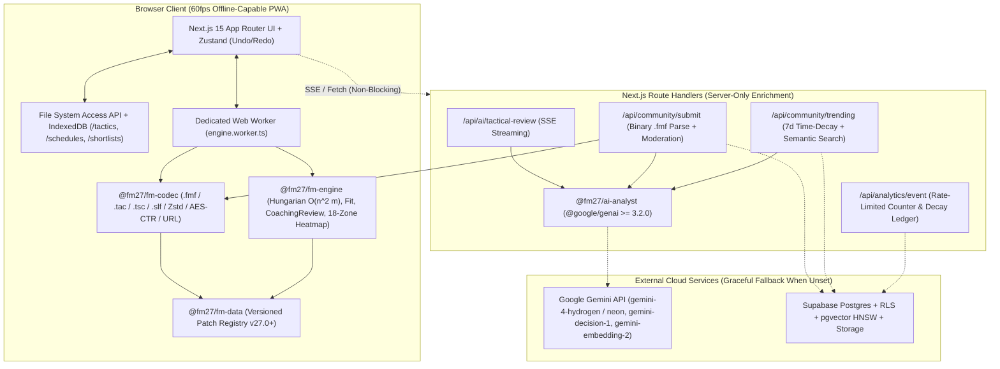

# Architecture & Architectural Decision Records (ADR)

## 1. System Overview

**FM27 Tactics Generator** replaces the legacy desktop WinForms (`.NET Framework 4.0`) + embedded Python sidecar (`FM27ClubRuntime`) architecture with a **client-first, patch-ready TypeScript monorepo** powered by Next.js 15, Web Workers, pure-TS binary `.fmf` codecs, Supabase (`pgvector` + RLS), and `@google/genai` (`Interactions API v1` & `Decisions API v1beta`).

---

## 2. Monorepo Package Boundaries

| Workspace Package | Responsibility | Runtime Environment |
| :--- | :--- | :--- |
| `@fm27/shared-types` | Single source of Zod schemas and inferred TypeScript types (`PitchCatalog`, `DualPhaseTactic`, `Player`, `StaffMember`, `WeeklySchedule`, `Wonderkid`, `CommunitySubmission`). | Isomorphic (Browser, Worker, Node) |
| `@fm27/fm-data` | Zero-logic JSON data registry (`versions/v27.0/*.json`), static Worker-safe loader, and cross-patch migrator (`migrateTacticToPatch`). | Isomorphic (Browser, Worker, Node) |
| `@fm27/fm-codec` | Byte-accurate `.fmf`, `.tac`, `_data/details.aom`, `.tsc`, `.slf` binary serializer/deserializer, pure-TS Zstandard Raw Block framer, Web Crypto `AES-128-CTR` (`afe.`), `.fm27.json`, and `lz-string` `#t=` URL sharing. | Isomorphic (Browser, Worker, Node) |
| `@fm27/fm-engine` | Deterministic mathematical core: `normalizePlayer`, `selectBestRole`, `computeSlotFit`, `solveHungarianMax`, `refineAssignment`, `reviewCoachingKnowledge`, 18-zone spatial heatmap, 6-pillar balance scorer, squad audit, wonderkid ranker, staff star calculator, training recommender, and `fmsave` / `FM-View-Exporter (F9)` CSV & HTML parsers. | Web Worker & Node |
| `@fm27/ai-analyst` | Server-side Gemini wrapper (`@google/genai >= 3.2.0`): `Interactions API v1` multi-turn SSE advisor, `Decisions API v1beta` (`gemini-decision-1`) zero-output-token safety/playstyle/quality moderator, `gemini-embedding-2` 768-dim semantic embeddings, and deterministic offline fallbacks. | Server-Only (Next.js Route Handlers) |
| `@fm27/web` | Next.js 15 App Router UI across `/`, `/squad`, `/wonderkids`, `/staff`, `/training`, `/community`, and `/community/[id]`. | Browser + Next.js Server |

---

## 3. Key Architectural Decisions (ADR)

### ADR-01: Strict Separation of Game Data from Engine Code (`@fm27/fm-data`)
- **Context:** Football Manager patches frequently adjust role eligibility, instruction bitmasks, conflict pairs, or coaching thresholds.
- **Decision:** Prohibit hardcoded role lists, bitmasks, style shapes, training impacts, or staff star thresholds inside `@fm27/fm-engine` or React components. Store all game constants in `packages/fm-data/versions/v<patch>/*.json` validated at CI time via `scripts/validate-data.mjs`.
- **Consequence:** Adding a new game patch (`pnpm data:new-patch 27.3 --from 27.0`) requires zero UI or engine rewrites.

### ADR-02: Pure-TS Zstandard Raw Block Framing for Zero-Native `.fmf` Export
- **Context:** Standard Zstandard compressors require native C/WASM bindings (~300+ KB) for compression, whereas Football Manager's Zstd reader natively accepts valid RFC 8878 Zstandard frames containing uncompressed Raw Blocks (`Block_Type = 0`).
- **Decision:** Encode `.fmf` member frames using our 50-line `zstd-raw-frame.ts` (`28 B5 2F FD A0` + 4-byte FCS + 64 KB raw blocks) and decode arbitrary compressed `.fmf` archives via lightweight `fzstd` (~8 KB) with a strict 16 MiB decompression cap.
- **Consequence:** 100% browser/Web-Worker compatible `.fmf` import and export with zero native DLLs and built-in zip-bomb protection.

### ADR-03: Client-First Web Worker Execution & Graceful Cloud Degradation
- **Context:** Running the Hungarian Solver ($O(n^2 m)$ across 13 styles $\times$ 16 dual-phase shapes + local swap refinement) on the main UI thread would drop frames below 60fps; relying on external APIs for core features would break offline usage.
- **Decision:** Dispatch all `@fm27/fm-engine` and `@fm27/fm-codec` operations through `engine.worker.ts`, and provide deterministic fallbacks whenever `GEMINI_API_KEY` or `NEXT_PUBLIC_SUPABASE_URL` are unset.
- **Consequence:** Core tactic building, `.fmf` round-trip, 18-zone heatmaps, squad audits, staff calculations, and training builders run 100% locally offline, while AI & cloud community features enhance the experience seamlessly when connected.

### ADR-04: Zero-Screenshot Community Gallery via Binary `.fmf` Parsing
- **Context:** Traditional FM community sites require manual screenshots that go stale or misrepresent actual in-game instructions.
- **Decision:** Parse uploaded `.fmf` binaries on both client and server via `parseFmf`, extract exact IP/OOP formations, Mentality, and 11 dual-phase roles, render automatic SVG pitch miniatures (`AutoTacticThumbnail`), and classify safety/playstyle in zero output tokens via `gemini-decision-1` (`v1beta`).
